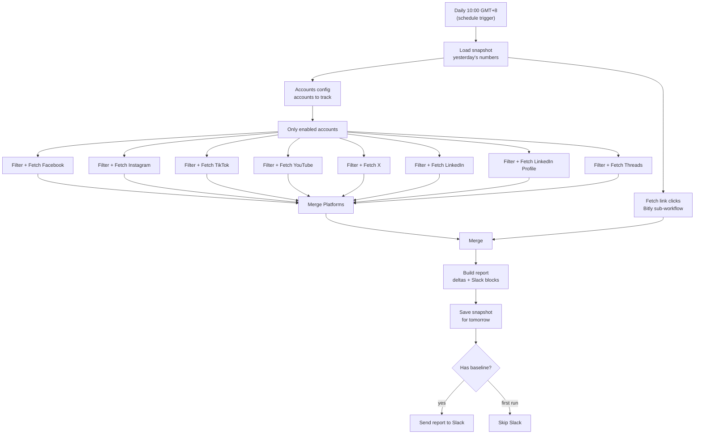
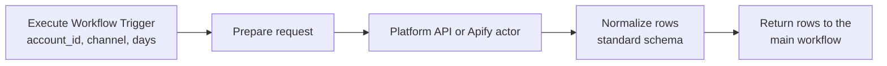
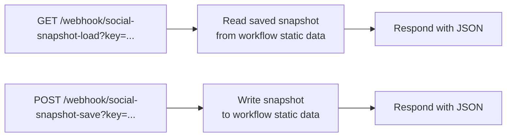

# Social Daily Report (n8n)

A set of n8n workflows that pulls performance numbers from your social accounts every morning and posts **one consolidated report to Slack**, with changes compared to the previous run.

Platforms: Facebook, Instagram, TikTok, YouTube, X, LinkedIn (company page + personal profile), Threads, plus link clicks from Bitly.

## What is in here

| File | Role |
| --- | --- |
| `Social Daily Report - New Layout.json` | **Main workflow.** Runs at 10:00 (GMT+8), calls each fetcher, builds the report, posts to Slack. |
| `Social Snapshot Store.json` | Tiny webhook "database" that stores yesterday's numbers so the report can show deltas. |
| `Social Fetch - Facebook New.json` | Fetcher (Graph API). |
| `Social Fetch - Instagram New.json` | Fetcher (Graph API). |
| `Social Fetch - TikTok.json` | Fetcher (Apify). |
| `Social Fetch - YouTube.json` | Fetcher (YouTube Data API). |
| `Social Fetch - X.json` | Fetcher (Apify). |
| `Social Fetch - LinkedIn.json` | Fetcher for a company page (LinkedIn API). |
| `Social Fetch - Brand B LinkedIn Profile.json` | Fetcher for a personal profile (Apify). |
| `Social Fetch - Threads.json` | Fetcher (Threads API). |
| `Social Fetch - Bitly.json` | Click counts for tracked short links. |

Every fetcher is a sub-workflow that returns the same row schema (`platform, channel, id, title, views, likes, comments, permalink`), so adding a platform means adding one more fetcher.

## How it works

### Map of the main workflow

### Step by step

1. **Schedule.** A schedule trigger starts the run every day at 10:00 (GMT+8). Change the time in the trigger node.
2. **Load snapshot.** An HTTP request asks `Social Snapshot Store` for the numbers saved by the previous run.
3. **Accounts config.** One Code node holds the list of accounts (`platform`, `channel`, `account_id`, `enabled`). It is the only place you edit to add, remove or disable an account.
4. **One fetcher per platform.** Each platform has a Filter node and an Execute Workflow node. The Filter keeps only that platform's accounts. The Execute Workflow node calls the matching `Social Fetch - ...` sub-workflow once per account.
5. **Same row format everywhere.** Every fetcher returns rows with the same fields (`platform, channel, id, title, views, likes, comments, permalink`), so the rest of the flow does not care where the data came from.
6. **Merge.** `Merge Platforms` combines all fetcher outputs. `Merge` adds the Bitly link clicks.
7. **Build report.** One Code node compares today's rows with the snapshot to get the day-over-day change, then builds a Slack message (Block Kit blocks, plus a short plain-text fallback for notifications).
8. **Save snapshot.** Today's numbers are stored for tomorrow's comparison.
9. **Send to Slack.** On the very first run there is nothing to compare against, so the run only saves a baseline and skips Slack. Every later run posts the report.

### Map of a fetcher (sub-workflow)

The exact nodes differ per platform (for example, Facebook makes extra calls for post insights and Threads picks a credential per brand). The input and the output are always the same.

### Map of the snapshot store

It keeps the snapshot in n8n's workflow static data, so it needs no external database. Static data is only saved when the workflow runs from a production webhook, so keep `Social Snapshot Store` **active**.

## Send the report to Slack with a Slack bot

The last node posts the message as a Slack bot, not with a webhook URL.

1. Go to https://api.slack.com/apps and click **Create New App** → **From scratch**. Pick your workspace.
2. Open **OAuth & Permissions** → **Bot Token Scopes** and add:
   - `chat:write` to post messages.
   - `channels:read` (and `groups:read` for private channels) if the node cannot load your channel list when you pick the channel by name.
3. Click **Install to Workspace** and copy the **Bot User OAuth Token**. It starts with `xoxb-`.
4. In Slack, create the channel (the workflow uses `social-reports` as an example) and invite the bot: type `/invite @your-bot-name` in the channel. A bot can only post in channels it has joined.
5. In n8n, create a **Slack API** credential (Access Token) and paste the `xoxb-` token. Choose it in the **Send report to Slack** node and select your channel.
6. Run the workflow. The node sends the Block Kit blocks built by **Build report** and a plain-text fallback, with link unfurling turned off.

Keep the `xoxb-` token inside the n8n credential. Never paste it into a node, a Code node or a commit.

## Everything sensitive was removed

These exports contain **no API keys, tokens, account IDs, emails or real brand names**. What you will see instead:

- Credentials are empty slots (`"id": ""`) with generic names. n8n asks you to pick or create them on import.
- Account IDs are placeholders such as `YOUR_FACEBOOK_PAGE_ID_A`.
- Brands are called `Brand A` and `Brand B`. Several fetchers route by that channel name, so if you rename one, rename it everywhere (search for it).
- Your n8n host is `https://YOUR_N8N_HOST`, and short links are `https://short.example.com/...`.
- Workflow IDs are `REPLACE_WITH_..._WORKFLOW_ID` (see step 3).

## Setup

1. **Import** all 11 files into n8n (Workflows → Import from file).
2. **Create credentials** and attach them in each fetcher:

   | Used by | Credential type |
   | --- | --- |
   | Facebook, Instagram | Facebook Graph API (Page / System User token) and Instagram |
   | TikTok, X, LinkedIn Profile | Apify API |
   | YouTube | YouTube OAuth2 |
   | LinkedIn | LinkedIn OAuth2 (organization scopes, see the sticky note in that workflow) |
   | Threads | HTTP Query Auth (`access_token`), one per brand |
   | Bitly | HTTP Bearer Auth |
   | Daily Report | Slack API |

3. **Wire the workflow IDs.** After import, each workflow has a new ID. Put them into:
   - the `FETCHERS` object in the **Accounts config** node of the Daily Report, and
   - each **Fetch ...** (Execute Workflow) node in the Daily Report.
4. **Wire the snapshot store.** Activate `Social Snapshot Store`, then set the **Load snapshot** and **Save snapshot** nodes to its production webhook URLs (`https://YOUR_N8N_HOST/webhook/social-snapshot-load` and `.../social-snapshot-save`).
5. **Fill in your accounts** in **Accounts config** (`platform`, `channel`, `account_id`, `enabled`). Set `enabled: false` to skip one.
6. **Set your links.** `TRACKED_LINKS` / `MASTERCLASS_LINKS` in **Build report** must match **Tracked links** in the Bitly workflow.
7. Pick the Slack channel in **Send report to Slack**, then run **Test manually**. The first run only stores a baseline and does not post to Slack (the `Has baseline?` node); the second run posts the first real report.

## Security notes

- The snapshot webhooks have **no authentication**. Anyone who knows the URL can read or overwrite the stored snapshot. Add a Header Auth to both Webhook nodes (and the two HTTP Request nodes that call them), or keep your n8n instance private.
- Short-lived Meta user tokens expire after about 60 days. Use a System User token (no expiry) for Facebook and Instagram.
- Threads long-lived tokens expire after 60 days and need refreshing.
- Never commit your own exports without checking for credentials, account IDs and webhook URLs first.

## How it is built

`Daily 10:00` → `Load snapshot` → `Accounts config` → `Only enabled accounts` → one `Filter` + `Fetch` pair per platform → `Merge Platforms` → `Merge` (with Bitly clicks) → `Build report` → `Save snapshot` → `Send report to Slack`.

There is one Execute Workflow node per platform on purpose. A single dynamic node that mixes repeated and different workflow IDs crashes n8n (`assignPairedItems`).

To add a platform: build a `Social Fetch - <Platform>` workflow, add a Filter/Fetch pair, raise the `Merge Platforms` input count, and add the platform to `PLATFORM_ORDER` and `PLATFORM_LOGOS` in **Build report**.

## License

MIT, see [LICENSE](LICENSE).
